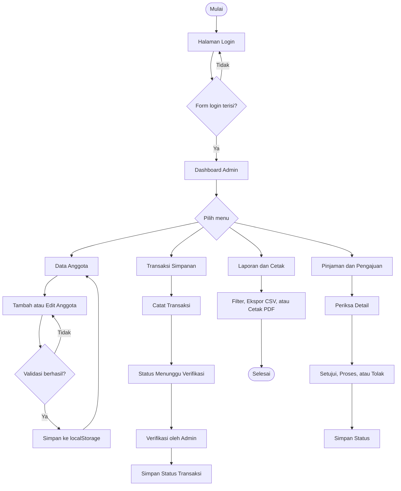
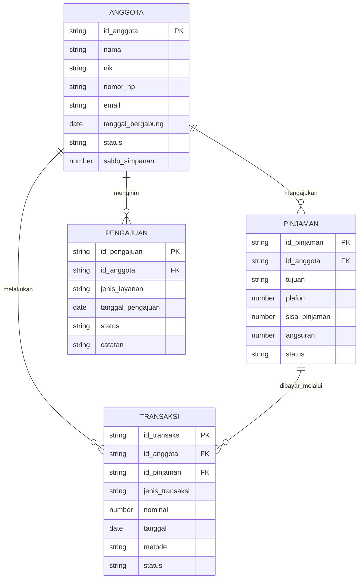

# PERANCANGAN SISTEM KOPSIMPAN

**Mata kuliah:** Pemrograman Web 2 (Client-Side Programming)  
**Topik:** Sistem Informasi Koperasi Simpan Pinjam  
**Nama proyek:** KopSimpan Admin Tugas PemWeb2  
**Pendekatan visual:** Material Design dengan warna hijau finansial, aksen kuning, permukaan bersih, dan sudut membulat.

## 1. Ringkasan proyek

KopSimpan merupakan prototipe antarmuka admin panel untuk membantu pengurus koperasi mengelola data anggota, simpanan, pinjaman, pengajuan layanan, transaksi, dan laporan. Proyek berfokus pada pengalaman pengguna, arsitektur informasi, responsivitas, dan interaktivitas client-side. Prototipe tidak memakai backend. Data contoh disimpan di `localStorage` browser.

## 2. Referensi desain Stitch dan Figma

Desain acuan berasal dari file ZIP Stitch AI yang disertakan pada tugas. Screenshot referensi ditampilkan di bawah ini.

### Dashboard admin


### Halaman login


### Dashboard anggota


### Modal pembayaran setoran dan angsuran


### Status pengajuan dan transaksi


### Style guide


**Link publik project Stitch:** https://stitch.withgoogle.com/preview/14330063945038227584?node-id=e3e2467a32e84c61a8086dc4d9eee637.

**Link publik project Figma:** https://www.figma.com/design/2WTRDQ6xU7tQNLCnLFKzsA/Untitled?node-id=0-1&t=eOkFG7YQfAcCD6tS-1.

> Catatan: ZIP yang diterima memuat kode HTML, screenshot, dan design system, tetapi tidak memuat URL publik Stitch atau Figma. Tautan publik perlu ditambahkan dari akun pemilik desain agar tidak menggunakan URL yang keliru.

## 3. Hirarki menu

```text
KopSimpan Admin Panel
├── Login Admin
└── Menu Utama
    ├── Dashboard Admin
    │   ├── Ringkasan anggota
    │   ├── Ringkasan simpanan
    │   ├── Ringkasan pinjaman
    │   ├── Grafik arus kas
    │   └── Setoran menunggu verifikasi
    ├── Dashboard Anggota
    │   ├── Ringkasan simpanan pribadi
    │   ├── Pinjaman berjalan
    │   └── Aktivitas transaksi
    ├── Data Anggota
    │   ├── Daftar anggota
    │   ├── Cari dan filter anggota
    │   ├── Detail anggota
    │   ├── Tambah anggota
    │   ├── Edit anggota
    │   └── Hapus anggota
    ├── Form Anggota
    │   ├── Identitas anggota
    │   ├── Informasi keanggotaan
    │   └── Validasi input
    ├── Transaksi Simpanan
    │   ├── Riwayat transaksi
    │   ├── Catat setoran
    │   ├── Verifikasi transaksi
    │   └── Ekspor CSV
    ├── Pinjaman dan Setoran
    │   ├── Daftar pinjaman
    │   ├── Detail pinjaman
    │   └── Simulasi persetujuan pinjaman
    ├── Status Pengajuan
    │   ├── Pendaftaran anggota
    │   ├── Pengajuan pinjaman
    │   ├── Perubahan data
    │   └── Pembaruan status
    └── Laporan dan Cetak
        ├── Filter periode
        ├── Grafik transaksi
        ├── Rincian aktivitas
        ├── Ekspor CSV
        └── Cetak laporan
```

## 4. User flow
## User Flow Anggota

1. Anggota membuka halaman login.
2. Anggota masuk ke dashboard.
3. Anggota melihat ringkasan simpanan dan pinjaman.
4. Anggota mengajukan pinjaman baru.
5. Sistem menyimpan pengajuan dengan status
   Menunggu Persetujuan.
6. Admin memeriksa pengajuan.
7. Admin menyetujui atau menolak pengajuan.
8. Anggota memeriksa status pengajuan.

## User Flow Admin

1. Admin login.
2. Admin membuka dashboard.
3. Admin mengelola data anggota.
4. Admin memverifikasi pengajuan pinjaman.
5. Admin memeriksa transaksi.
6. Admin membuka laporan.



## 5. Konsep ER-D sederhana

Diagram berikut menggambarkan entitas logis yang menjadi dasar data mock. Relasi diterapkan pada struktur data JavaScript, bukan database server.



## 6. Design system

### 6.1 Palet warna

| Token | HEX | Penggunaan |
|---|---|---|
| Primary | `#005136` | Sidebar, tombol utama, navigasi aktif |
| Primary secondary | `#176B4B` | Aksen merek dan interaksi |
| Primary soft | `#E4F3EB` | Tombol sekunder dan permukaan terpilih |
| Canvas | `#F1FAF4` | Latar utama aplikasi |
| Surface | `#FFFFFF` | Kartu, tabel, modal |
| Gold accent | `#FFC247` | Peringatan, status menunggu, grafik |
| Blue accent | `#1769AA` | Informasi dan ringkasan pinjaman |
| Error | `#B42332` | Aksi hapus dan status bermasalah |
| Text | `#14231B` | Teks utama |
| Muted | `#65766B` | Teks sekunder |

### 6.2 Tipografi

- Font utama: Inter.
- Judul halaman: 23 sampai 29 px, bobot 700 atau 800.
- Judul panel: 13 sampai 15 px, bobot 700.
- Teks isi: 11 sampai 14 px.
- Data nominal menggunakan angka rupiah dengan pemformatan lokal Indonesia.

### 6.3 Komponen reusable

- Tombol utama, sekunder, outline, bahaya, dan tombol ikon.
- Kartu ringkasan statistik.
- Badge status: aktif, menunggu verifikasi, diproses, disetujui, dan ditolak.
- Tabel data dengan pencarian, filter, dan aksi.
- Form input dengan validasi client-side.
- Modal detail dan konfirmasi.
- Toast untuk umpan balik aksi.
- Sidebar responsif dan header navigasi.
- Grafik batang dan doughnut dengan Chart.js.

### 6.4 Prinsip responsivitas

- Desktop memakai sidebar tetap di sisi kiri dan area konten yang fleksibel.
- Tablet dan ponsel memakai sidebar yang dapat dibuka melalui tombol menu.
- Grid kartu berubah dari empat kolom menjadi dua kolom pada layar kecil.
- Tabel memakai area gulir horizontal agar data tetap terbaca di layar sempit.
- Formulir berubah menjadi satu kolom pada layar ponsel.

## 7. Halaman yang diimplementasikan

| Halaman | File | Fungsi utama |
|---|---|---|
| Login | `index.html` | Simulasi masuk admin |
| Dashboard Admin | `pages/dashboard.html` | Ringkasan, grafik, dan setoran tertunda |
| Dashboard Anggota | `pages/dashboard-anggota.html` | Ringkasan simpanan pribadi, pinjaman, dan aktivitas |
| Data Anggota | `pages/anggota.html` | Cari, filter, lihat, edit, dan hapus anggota |
| Form Anggota | `pages/form-anggota.html` | Tambah dan edit anggota dengan validasi |
| Transaksi Simpanan | `pages/transaksi.html` | Catat, lihat, dan verifikasi transaksi |
| Pinjaman dan Setoran | `pages/pinjaman.html` | Pantau pinjaman dan simulasi persetujuan |
| Status Pengajuan | `pages/pengajuan.html` | Periksa dan perbarui status pengajuan |
| Laporan dan Cetak | `pages/laporan.html` | Filter periode, grafik, ekspor CSV, dan cetak |

## 8. Penyimpanan dan validasi

Aplikasi menggunakan `localStorage` untuk menyimpan data anggota, transaksi, pinjaman, pengajuan, sesi demo, dan preferensi tema. Form anggota memeriksa nama, NIK numerik, nomor HP, format email, dan duplikasi NIK. Form transaksi memeriksa pilihan anggota, tanggal, dan nominal minimal. Aksi penghapusan menggunakan modal konfirmasi.

## 9. Batasan prototipe

Proyek ini hanya mendemonstrasikan antarmuka dan interaksi client-side. Data tidak tersinkron antarperangkat, login tidak memberikan keamanan autentikasi sebenarnya, dan nominal yang tampil merupakan data simulasi. Untuk penggunaan operasional, aplikasi perlu backend, database, pengelolaan akses, audit trail, dan pengamanan data.

## 10. Checklist milestone

- [x] Milestone 1: dokumentasi menu, user flow, konsep ER-D, dan design system.
- [x] Milestone 2: layout HTML dan CSS responsif.
- [x] Milestone 3: halaman spesifik, data mock, grafik, validasi, modal, filter, ekspor, dan cetak.
- [x] Tambahkan URL publik Stitch AI dan Figma setelah link dari akun desain tersedia.
- [ ] Unggah repository ke GitHub atau GitLab dan lakukan deploy ke GitHub Pages atau Vercel.


## Penyempurnaan Role-Based Demo

Fitur tambahan mempertahankan rancangan visual awal dan menambahkan alur autentikasi Admin/Anggota, halaman verifikasi pinjaman, kelola akun anggota, pengajuan pinjaman, validasi formulir, empty state, serta penanganan kegagalan localStorage. Seluruh data tetap bersifat simulasi browser.
